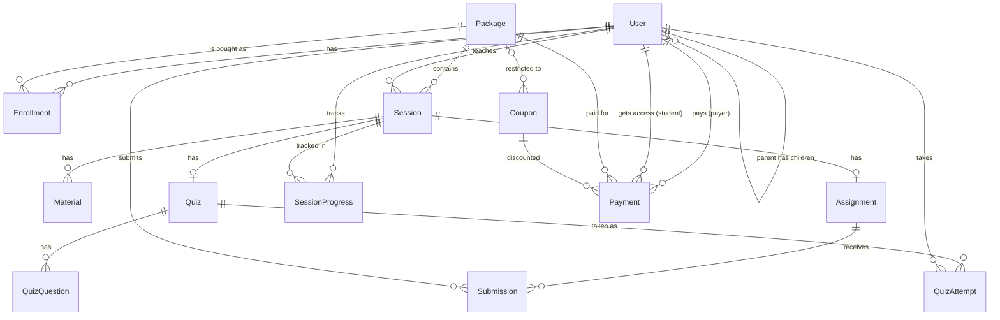

# Codiq database schema

PostgreSQL via Prisma. Source of truth: `backend/prisma/schema.prisma`. Prices are in piasters (1 EGP = 100).

| Table | Purpose | Key fields |
|---|---|---|
| User | Everyone: students, parents, instructors, admins | email (unique), passwordHash, googleId, role, track, parentId, avatarKey, avatarUrl, refreshTokenHash, resetTokenHash |
| Package | A purchasable course bundle | slug, track, priceOneTime, priceMonthly, installmentsAllowed, isPublished |
| Session | One class (live or recorded) | packageId, order, type, startsAt, instructorId, videoKey |
| Material | Files attached to a session | fileKey, sizeBytes, mimeType |
| Assignment | Homework for a session (one per session) | brief, dueAt, maxScore |
| Submission | A student's answer | text, fileKey, score, feedback, status |
| Quiz / QuizQuestion / QuizAttempt | Auto-graded multiple choice | options, correctIndex, passScore, answers, score |
| Enrollment | Access to a package (unique per user and package) | billing, status, activeUntil (null = lifetime) |
| Payment | Every payment attempt | payerId, studentId, amount (after discount), discountAmount, couponId, method, status, provider, providerRef, receiptKey, raw |
| Coupon | Discount codes (percent or fixed EGP) | code (unique), type, value, maxRedemptions, redeemedCount, expiresAt, packageId / track (optional limits), active |
| SessionProgress | Watching and attendance | watchedSeconds, completed, attendedLive |

Enums: Role (STUDENT, PARENT, INSTRUCTOR, ASSISTANT, ADMIN), CouponType (PERCENT, FIXED), Track (KIDS, SCHOOL, COLLEGE), SessionType, BillingType, EnrollmentStatus, PaymentMethod (CARD, WALLET, INSTALLMENTS, FAWRY, INSTAPAY), PaymentStatus (PENDING, AWAITING_REVIEW, PAID, FAILED, REFUNDED), SubmissionStatus.

Deleting a user removes their enrollments, progress, submissions and quiz attempts. Users with payments can't be deleted (payment records are kept).
